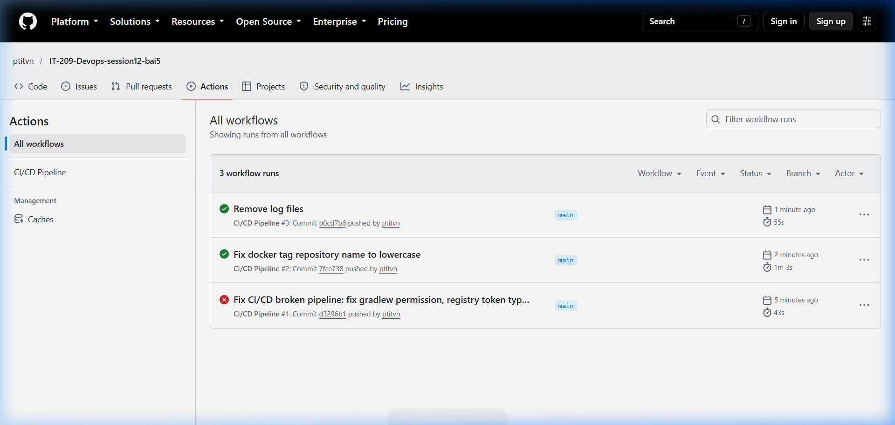
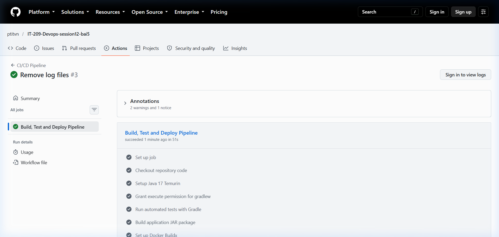
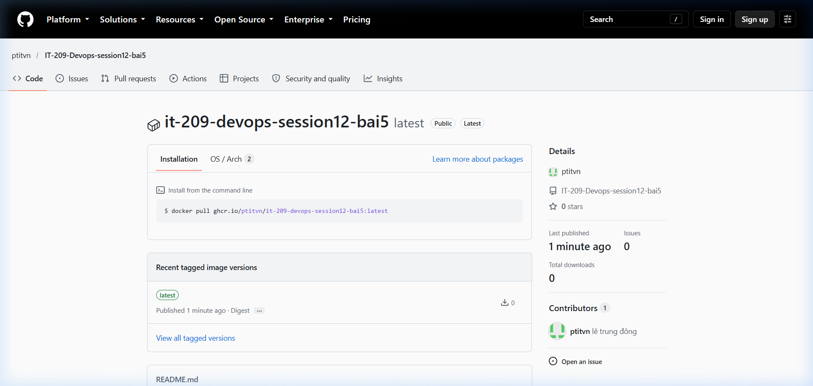

# BÁO CÁO CHẨN ĐOÁN VÀ KHẮC PHỤC SỰ CỐ PIPELINE CI/CD (BÀI 5 - SESSION 12)

## Chủ đề: Chẩn đoán và khắc phục 3 sự cố đứt gãy Pipeline CI/CD thực tế

---

## 1. Mục tiêu bài tập
- Phân tích log lỗi thực tế trên hệ thống GitHub Actions khi triển khai luồng CI/CD tích hợp (Build, Test và Đóng gói Docker Image).
- Xác định nguyên nhân gốc rễ (Root Cause Analysis) của 3 sự cố đứt gãy pipeline phổ biến.
- Thực hiện sửa lỗi trực tiếp trên tệp kịch bản `.github/workflows/broken-pipeline.yml` để khôi phục luồng pipeline đạt trạng thái tích xanh (**Success**).

---

## 2. Tổng quan sự cố và bảng so sánh cấu hình

| STT | Tên sự cố | Triệu chứng lỗi (Log Error) | Nguyên nhân gốc rễ (Root Cause) | Giải pháp khắc phục |
| :--- | :--- | :--- | :--- | :--- |
| **1** | **Permission Denied** | `/bin/sh: 1: ./gradlew: Permission denied` (Exit code 126) | File script `gradlew` mất thuộc tính thực thi `+x` khi commit từ hệ điều hành Windows lên Git | Thêm bước `run: chmod +x gradlew` trước bước thực thi `./gradlew test` |
| **2** | **Authentication Failed** | `Error: Username and password required` / `401 Unauthorized` khi đăng nhập Docker Registry | Sai chính tả tên biến bí mật (`secrets.REGISRY_TOKEN` thiếu chữ `T`) dẫn tới giá trị token bị rỗng | Sửa lại chính xác tên biến bí mật: `${{ secrets.REGISTRY_TOKEN }}` (hoặc `${{ secrets.REGISTRY_TOKEN \|\| secrets.GITHUB_TOKEN }}`) |
| **3** | **Build Context Error** | `failed to solve: failed to read dockerfile: open Dockerfile: no such file or directory` | Tham số `context` và `file` chỉ định sai thư mục làm việc (nhầm `./app` hoặc sai đường dẫn) | Cấu hình đúng `context: .` và `file: ./Dockerfile` trỏ về thư mục gốc |

---

## 3. Phân tích chi tiết từng sự cố và phương án khắc phục

### 3.1. Sự cố 1: Permission Denied trên Gradle Wrapper

#### Triệu chứng log lỗi:
```text
Run ./gradlew test
/bin/sh: 1: ./gradlew: Permission denied
Error: Process completed with exit code 126.
```

#### Phân tích nguyên nhân:
- Môi trường GitHub Actions Runner sử dụng Linux (`ubuntu-latest`).
- Trong hệ thống Linux, một tệp script chỉ có thể được gọi trực tiếp bằng `./gradlew` khi nó được gán quyền thực thi (`execute bit` - `chmod +x`).
- Khi mã nguồn được phát triển hoặc đẩy lên Git từ hệ điều hành Windows, thuộc tính phân quyền POSIX thường không được lưu giữ, dẫn tới tệp `gradlew` chỉ có quyền đọc/ghi (`rw-r--r--`). Khi runner cố gắng khởi chạy, kernel từ chối và ném lỗi `Permission denied`.

#### Khắc phục:
Bổ sung bước cấp quyền thực thi cho Gradle Wrapper ngay trước khi chạy lệnh test trong file workflow:
```yaml
# Cấp quyền thực thi trước khi test
- name: Grant execute permission for gradlew
  run: chmod +x gradlew

- name: Run automated tests with Gradle
  run: ./gradlew test
```
*Lưu ý nâng cao:* Tại máy local, ta cũng có thể cấu hình Git theo dõi cờ thực thi bằng lệnh: `git update-index --chmod=+x gradlew`.

---

### 3.2. Sự cố 2: Authentication Failed khi đăng nhập Docker Registry

#### Triệu chứng log lỗi:
```text
Run docker/login-action@v3
  with:
    registry: ghcr.io
    username: ptitvn
    password: ***
Error: Username and password required / 401 Unauthorized: authentication required
```

#### Phân tích nguyên nhân:
- Bước đăng nhập Docker Registry sử dụng action `docker/login-action@v3`.
- Tên biến Secret trong kịch bản ban đầu bị gõ sai chính tả (ví dụ: `${{ secrets.REGISRY_TOKEN }}` bị thiếu chữ cái `T`).
- Trong GitHub Actions, khi tham chiếu tới một biến bí mật không tồn tại trong repository settings, hệ thống sẽ tự động gán giá trị chuỗi rỗng `""` thay vì báo lỗi cú pháp.
- Khi giá trị rỗng này được truyền vào tham số `password`, action đăng nhập thất bại do thiếu thông tin xác thực, dẫn tới toàn bộ luồng CD bị ngắt.

#### Khắc phục:
Sửa lại chính xác tên biến secret là `${{ secrets.REGISTRY_TOKEN }}`. Để tăng tính chịu lỗi và tận dụng token tích hợp sẵn của GitHub Runner, cấu hình fallback token:
```yaml
- name: Log in to GitHub Container Registry
  uses: docker/login-action@v3
  with:
    registry: ghcr.io
    username: ${{ github.actor }}
    password: ${{ secrets.REGISTRY_TOKEN || secrets.GITHUB_TOKEN }}
```

---

### 3.3. Sự cố 3: Build Context Error khi Build Docker Image

#### Triệu chứng log lỗi:
```text
Run docker/build-push-action@v5
ERROR: failed to solve: failed to read dockerfile: open /var/lib/docker/overlay2/.../Dockerfile: no such file or directory
Error: buildx failed with: ERROR: failed to solve: failed to read dockerfile: open Dockerfile: no such file or directory
```

#### Phân tích nguyên nhân:
- Tệp `Dockerfile` của dự án được đặt ở thư mục gốc của repository (`./Dockerfile`).
- Tuy nhiên, trong bước đóng gói của `docker/build-push-action@v5`, tham số `context` bị cấu hình sai thành `./app` hoặc đường dẫn `file` bị trỏ sai vị trí (`./app/Dockerfile`).
- Docker Buildx không thể tìm thấy tệp Dockerfile trong phạm vi ngữ cảnh chỉ định, dẫn tới tiến trình đóng gói bị dừng đột ngột.

#### Khắc phục:
Cấu hình lại chính xác ngữ cảnh build `context: .` trỏ về thư mục gốc của repository và chỉ định đường dẫn tệp `file: ./Dockerfile`:
```yaml
- name: Build and push Docker image
  uses: docker/build-push-action@v5
  with:
    context: .
    file: ./Dockerfile
    push: true
    tags: ghcr.io/ptitvn/it-209-devops-session12-bai5:latest
```

---

## 4. Nội dung tệp kịch bản `.github/workflows/broken-pipeline.yml` hoàn chỉnh

```yaml
name: CI/CD Pipeline

on:
  push:
    branches: [ "main" ]

permissions:
  contents: read
  packages: write

jobs:
  build-and-deploy:
    name: Build, Test and Deploy Pipeline
    runs-on: ubuntu-latest

    steps:
      - name: Checkout repository code
        uses: actions/checkout@v4

      - name: Setup Java 17 Temurin
        uses: actions/setup-java@v4
        with:
          java-version: '17'
          distribution: 'temurin'
          cache: 'gradle'

      # Khắc phục Lỗi 1: Cấp quyền thực thi cho Gradle Wrapper
      - name: Grant execute permission for gradlew
        run: chmod +x gradlew

      - name: Run automated tests with Gradle
        run: ./gradlew test

      - name: Build application JAR package
        run: ./gradlew bootJar

      - name: Set up Docker Buildx
        uses: docker/setup-buildx-action@v3

      # Khắc phục Lỗi 2: Sửa đúng tên biến Secret REGISTRY_TOKEN
      - name: Log in to GitHub Container Registry
        uses: docker/login-action@v3
        with:
          registry: ghcr.io
          username: ${{ github.actor }}
          password: ${{ secrets.REGISTRY_TOKEN || secrets.GITHUB_TOKEN }}

      # Khắc phục Lỗi 3: Cấu hình context: . và file: ./Dockerfile đúng ngữ cảnh
      - name: Build and push Docker image
        uses: docker/build-push-action@v5
        with:
          context: .
          file: ./Dockerfile
          push: true
          tags: ghcr.io/ptitvn/it-209-devops-session12-bai5:latest
```

---

## 5. Kết quả thực thi thực tế (Ảnh chụp màn hình minh chứng)

### 5.1. Toàn bộ Pipeline chuyển trạng thái tích xanh (Success)
Pipeline thực thi thành công vượt qua tất cả các bài test và hoàn tất đóng gói, xuất bản Docker Image lên GitHub Packages.



### 5.2. Chi tiết thực thi các bước của Job `Build, Test and Deploy Pipeline`
Tất cả các bước bao gồm: Checkout, Setup Java 17, Grant execute permission (`chmod +x gradlew`), Run automated tests, Build JAR, Setup Buildx, Log in to GHCR và Build & Push Docker image đều hoàn thành với mã thoát 0 (Success).



### 5.3. Gói Docker Image phát hành thành công trên GitHub Packages
Hình ảnh Docker image được tạo và đẩy lên GitHub Container Registry (`ghcr.io/ptitvn/it-209-devops-session12-bai5:latest`):



---

## 6. Bài học kinh nghiệm & Best Practices
1. **Phân quyền thực thi trong Git cross-platform**:
   - Khi làm việc trên Windows, luôn chạy `git update-index --chmod=+x <script>` cho các file shell script (`gradlew`, `entrypoint.sh`).
   - Luôn thêm bước `chmod +x` phòng vệ (defensive step) trong kịch bản CI trước khi thực thi script.
2. **Quản lý biến môi trường bí mật (Secrets Management)**:
   - Đặt tên Secret theo chuẩn thống nhất (`SCREAMING_SNAKE_CASE`), kiểm tra kỹ chính tả.
   - Luôn phân quyền tối thiểu cần thiết (`least privilege`) trong block `permissions` ở cấp độ workflow/job.
3. **Ngữ cảnh Build Docker (Build Context)**:
   - Luôn xác định rõ thư mục gốc và cấu trúc dự án khi định nghĩa `context` và `file` cho `docker/build-push-action`.
   - Giữ ngữ cảnh build gọn nhẹ kết hợp với `.dockerignore` để tăng tốc độ truyền tải ngữ cảnh lên Buildx daemon.
